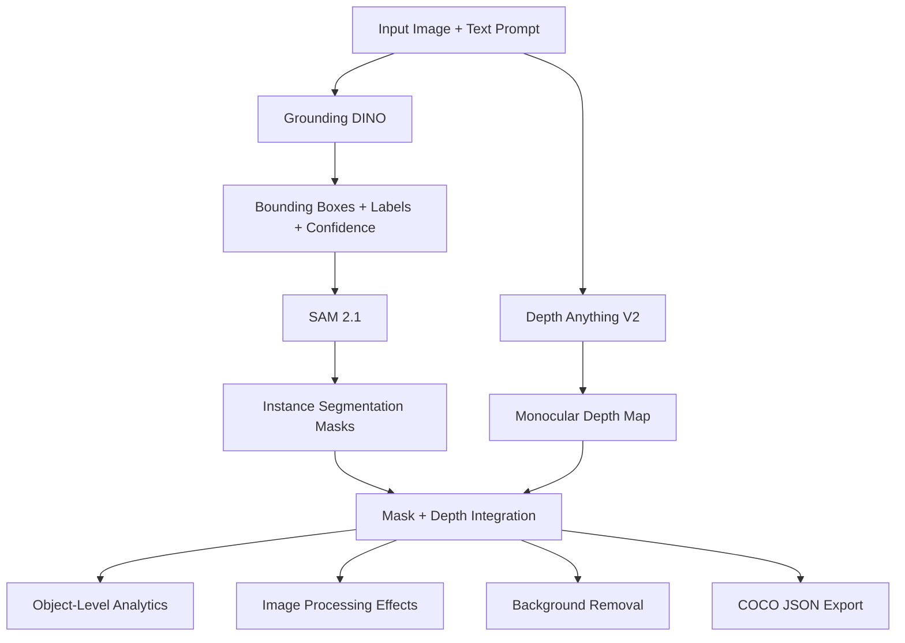
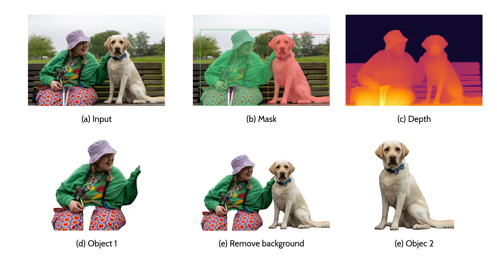

# Scene Studio: Segmentation and Background Removal

An integrated computer vision pipeline for text-guided object detection, instance segmentation, monocular depth estimation, and image manipulation using pretrained models — without requiring additional training or fine-tuning.


---

## Overview

Scene Studio is a modular computer vision pipeline that integrates three pretrained models to perform text-guided object detection, instance segmentation, monocular depth estimation, and image post-processing.

Given an input image and a natural-language text prompt (e.g., `person`, `dog`, or `car`), the system identifies target objects, generates pixel-level segmentation masks, estimates scene depth, and applies various image manipulation operations.

By combining open-vocabulary object detection with promptable segmentation, Scene Studio enables object localization and segmentation beyond a fixed set of predefined semantic classes.

The application provides an interactive Gradio interface for image processing and visualization, supporting both CPU and NVIDIA GPU inference.

## Key Features

- **Text-Guided Object Segmentation:** Detect and segment objects using natural-language prompts without being restricted to a predefined set of 80 COCO classes.
- **Background Removal:** Generate transparent backgrounds, solid-color backgrounds, or custom background replacements, with configurable edge refinement, object cropping, and original-resolution output.
- **Depth-Aware Image Processing:** Estimate monocular depth maps and apply depth-guided effects, including background blur, grayscale background, and background whitening.
- **Object-Level Analytics:** Calculate detection confidence, mask area ratios, and relative depth rankings for segmented objects.
- **Camera Integration:** Capture images through browser-based webcams or local cameras using OpenCV, with support for continuous live processing.
- **COCO Annotation Export:** Export segmentation results in COCO JSON format for dataset annotation and downstream computer vision workflows.

## System Architecture

The pipeline consists of three primary inference stages:



### Model Components

| Stage | Model | Function |
|:---|:---|:---|
| 1. Object Detection | Grounding DINO (Tiny) | Open-vocabulary object detection based on text prompts, producing bounding boxes, labels, and confidence scores. |
| 2. Instance Segmentation | SAM 2.1 | Generates pixel-level segmentation masks from the bounding boxes provided by Grounding DINO. |
| 3. Depth Estimation | Depth Anything V2 (Small) | Predicts monocular depth maps to represent the relative depth structure of the input scene. |

Each model component is implemented as an independent callable module, allowing individual replacement, configuration, and mocking during testing.

## Technology Stack

| Category | Technologies |
|:---|:---|
| Foundation Models | Grounding DINO, SAM 2.1, Depth Anything V2 |
| Deep Learning | PyTorch, Hugging Face Transformers, Ultralytics |
| Image Processing | OpenCV, Pillow, NumPy |
| Web Interface | Gradio |
| Backend API | FastAPI, Uvicorn |
| Configuration | YAML |
| Testing & Code Quality | pytest, Ruff, GitHub Actions |
| Project Configuration | pyproject.toml |

## Project Structure

```text
scene-studio/
├── configs/
│   └── default.yaml             # Default pipeline configuration
│
├── src/
│   └── scene_studio/
│       ├── models/               # Model wrappers and inference modules
│       ├── postprocess/          # Analytics, effects, background removal
│       ├── export/               # COCO annotation export
│       ├── utils/                # Image processing, device selection, camera
│       └── apps/                 # Gradio, FastAPI, and CLI interfaces
│
├── tests/                        # Automated tests
├── scripts/                      # Utility scripts
├── docs/                         # Architecture and technical documentation
├── results/                      # Demonstration images and outputs
│
├── app.py                        # Hugging Face Spaces entry point
├── pyproject.toml                # Package metadata and tool configuration
├── .env.example                  # Environment variable template
└── README.md
```

## Requirements

### Hardware and Software

- Python 3.10 or later.
- PyTorch 2.6 or a compatible version.
- NVIDIA GPU with a compatible CUDA-enabled PyTorch installation (optional).
- CPU inference is supported, although processing speed may be significantly lower.

### Dependencies

Project dependencies are managed through `pyproject.toml`.

Main dependencies include:

- `torch==2.6.0+cu124`
- `torchvision==0.21.0+cu124`
- `transformers>=4.51`
- `ultralytics>=8.3`
- `numpy`
- `pillow`
- `opencv-python-headless`
- `pyyaml`
- `gradio>=5`
- `fastapi`
- `uvicorn`
- `python-multipart`

Development dependencies include:

- `pytest`
- `ruff`

For systems without an NVIDIA GPU, install the CPU-compatible PyTorch distribution instead of the CUDA-specific packages.

## Configuration

The default configuration is defined in:

```text
configs/default.yaml
```

Only a few settings need to be adjusted:

- `device: auto` — Automatically uses an NVIDIA GPU when available; otherwise, falls back to CPU.
- For low-resource CPUs, use `segmenter: mobile_sam.pt` and reduce `max_side` to `640` to lower computational requirements.

## Installation and Usage

### 1. Create a Virtual Environment

```powershell
python -m venv .venv
.venv\Scripts\activate
```

### 2. Install Dependencies

```powershell
pip install -e .
```

### 3. Launch the Application

```powershell
scene-studio demo
```

Open the following URL in your browser:

```text
http://127.0.0.1:7860
```

### Camera Support

Allow camera access when prompted by the browser.

If browser-based webcam access is unavailable, use the **Local Camera** option powered by OpenCV.

## Experimental Results

### Application Interface


### Qualitative Results

The following example demonstrates the output generated by the proposed pipeline, including object segmentation and image processing results.



## Technical Notes

- All core vision models are pretrained; no additional training or fine-tuning is required.
- Grounding DINO performs text-conditioned object localization, while SAM 2.1 generates pixel-level segmentation masks.
- Depth Anything V2 provides monocular relative depth estimation, not metric depth measurements.
- Object removal and background manipulation are performed through downstream image processing operations.
- Inference performance depends on hardware specifications, input resolution, and model variants.
