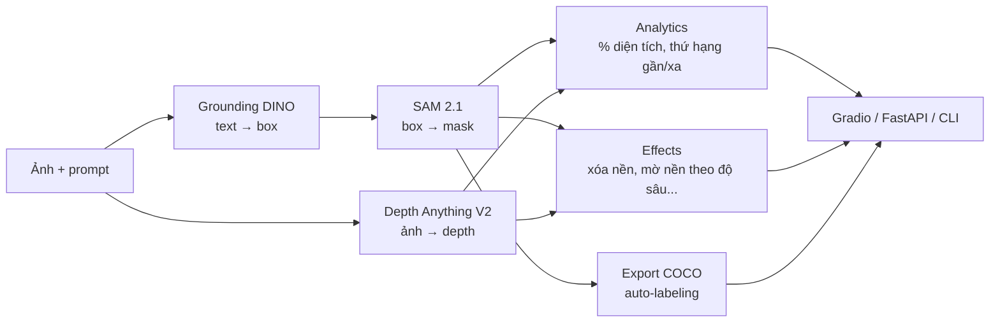

# Kiến trúc

## Nguyên tắc thiết kế
- **Stage = callable**: `ScenePipeline` chỉ cần 3 callable (detector, segmenter, depth), nên thay model hoặc mock khi test rất dễ.
- **Import nặng nằm trong `__init__` của model**: import package không kéo torch, test chạy nhanh trên CI.
- **Tách `run` và `render`**: chạy model một lần, đổi hiệu ứng nhiều lần mà không phải infer lại.
- **Registry hiệu ứng** (`postprocess/effects.py::EFFECTS`): thêm hiệu ứng mới = thêm 1 hàm + 1 dòng dict.

## Thêm một stage/model mới
1. Tạo class callable trong `models/` (ví dụ `inpainter.py`).
2. Nhận vào `ScenePipeline.__init__` hoặc dùng như một effect trong `postprocess/effects.py`.
3. Thêm test với bản giả trong `tests/conftest.py`.
